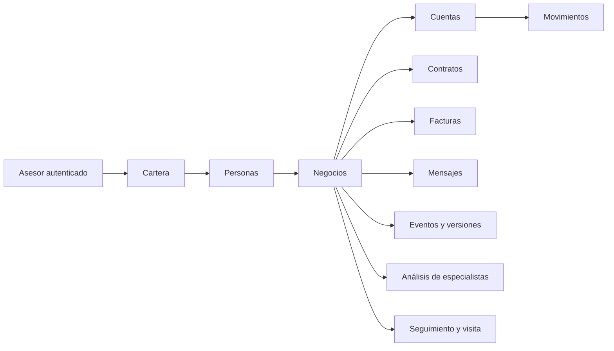
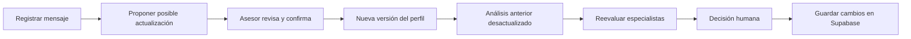

# Mype360 — resumen del proyecto y la base de datos

Estado revisado el **17 de octubre de 2026**. Este documento reúne la ubicación de la base, arquitectura, funcionalidades, datos y pendientes del MVP.

## 1. Dónde está la BD

La base remota es **PostgreSQL en Supabase**, dentro de un único proyecto:

| Dato | Valor |
| --- | --- |
| Proyecto | `hbpwibthtoernsejaulg` |
| Panel | [Abrir proyecto](https://supabase.com/dashboard/project/hbpwibthtoernsejaulg) |
| Tablas | [Abrir Table Editor](https://supabase.com/dashboard/project/hbpwibthtoernsejaulg/editor) |
| SQL | [Abrir SQL Editor](https://supabase.com/dashboard/project/hbpwibthtoernsejaulg/sql/new) |
| URL de API | `https://hbpwibthtoernsejaulg.supabase.co` |
| Host de Postgres | `db.hbpwibthtoernsejaulg.supabase.co` |
| Puerto / base / usuario | `5432` / `postgres` / `postgres` |
| Esquema del CRM | `public`, tablas con prefijo `mype_` |

No hay una base independiente para cada agente: todos los módulos del CRM comparten este proyecto. Las migraciones SQL del repositorio describen su estructura; los registros remotos viven en Supabase.

La conexión directa necesita la contraseña de Postgres. La web usa la API pública y una sesión de Supabase Auth; no necesita recibir esa contraseña ni una clave administrativa. Este resumen no contiene contraseñas, claves privadas ni tokens.

## 2. Estado real de los datos

**La comprobación remota de esta revisión encontró cero filas en las once tablas del CRM.** El esquema está creado y probado, pero no hay todavía una cartera guardada por un asesor.

Los diez clientes que aparecen al abrir la web pertenecen a la **demo local**. Sus cambios se conservan en `localStorage`, bajo la clave `mype360-workspace-v1`. No se suben automáticamente a Supabase. Las pruebas remotas usaron datos transaccionales y terminaron con `ROLLBACK`, por eso no dejaron carteras ni usuarios de prueba.

| Modo de la pantalla | Dónde están los datos | Cómo se guardan |
| --- | --- | --- |
| Demo local | Navegador de ese dispositivo | Automáticamente en almacenamiento local |
| Supabase | BD PostgreSQL de este proyecto | Con sesión y botón **Guardar cambios** |

### Crear la primera cartera remota

1. Abrir la web y pulsar **Conectar Supabase**.
2. Iniciar sesión o usar **Crear acceso demo**; confirmar el correo si el proyecto lo exige.
3. Pulsar **Cargar mi cartera**. Si el usuario es nuevo, se prepara su cartera sintética.
4. Pulsar **Guardar cambios**. Se guardan el documento de cartera y las tablas relacionadas en una única transacción.
5. Revisar el Table Editor o pulsar **Recargar cartera** en la web.

**Cargar mi cartera no importa las modificaciones de la demo local.** Para conservarlas antes de cambiar de modo, usar **Exportar cartera**. Esta versión permite exportar, pero todavía no incorpora un importador de ese JSON ni una migración automática de local a remoto.

## 3. Qué contiene esa única BD

| Tabla | Qué guarda | Filas en esta revisión |
| --- | --- | ---: |
| `mype_workspaces` | Cartera completa, revisión y fecha de guardado | 0 |
| `mype_people` | Personas titulares de negocios | 0 |
| `mype_businesses` | Negocios y perfiles comerciales versionados | 0 |
| `mype_accounts` | Cuentas por negocio y moneda | 0 |
| `mype_movements` | Abonos y compras agregados por mes | 0 |
| `mype_contracts` | Productos existentes y vigencia | 0 |
| `mype_invoices` | Facturas, importes, vencimientos y elegibilidad simulada | 0 |
| `mype_messages` | Mensajes registrados como contexto | 0 |
| `mype_events` | Correcciones, perfil anterior, autor y fuente | 0 |
| `mype_runs` | Propuestas, descartes, evidencia y trazas de análisis | 0 |
| `mype_cases` | Notas, feedback, aprobación, borrador y postvisita | 0 |

Supabase Auth gestiona los usuarios en `auth.users`, fuera de estas once tablas. Las claves incluyen `owner_id`: las políticas RLS restringen cada cartera a su asesor.



Una persona puede ser titular de varios negocios. Sus cuentas, conversaciones y recomendaciones se mantienen separadas por negocio.

El documento principal del MVP está en `mype_workspaces.body`. La función `mype_save_workspace(document, expected_revision)` actualiza ese documento y sus proyecciones relacionales en una única transacción. La web utiliza esa función para guardar. Editar las tablas relacionadas manualmente no actualiza automáticamente el documento principal.

## 4. Datos sintéticos disponibles

El generador prepara, por cartera nueva:

- Nueve personas y diez negocios; un titular participa en dos negocios.
- Diez cuentas en PEN.
- 216 movimientos agregados: abonos y compras mensuales de nueve negocios durante doce meses.
- Un contrato vigente y dos facturas elegibles simuladas.
- Objetivos, preferencias de comunicación, necesidades y mensajes iniciales.
- Casos de capital de trabajo, cobros, factoring, producto ya existente, datos insuficientes y no ofrecer.

No son datos de clientes reales de BCP. Los datasets IBM AML y SAML-D explorados inicialmente no alimentan el perfil comercial de este MVP ni se cargaron en estas tablas. Tampoco se subieron los documentos de la hackatón a la BD: siguen siendo archivos del proyecto.

La generación es reproducible con semilla `42`, fecha `2026-10-17` y versión `mype-synthetic-1`. Desde `base-web`:

```sh
npm run demo:generate -- 42 2026-10-17 /tmp/mype360-demo.json
```

## 5. Qué hace la web

El producto es un **copiloto para el asesor comercial de MYPES**, usando banca peruana y BCP como referencia de negocio.

- Cartera con búsqueda y selección de clientes.
- Perfil con indicadores económicos, objetivos, preferencias, cobertura y evidencia.
- Conversación registrada y notas privadas por negocio.
- Propuestas de productos con condiciones, razones y alternativas descartadas.
- Revisión de riesgo y conveniencia para el cliente.
- Aprobación o rechazo comercial por parte del asesor.
- Ficha de visita descargable, borrador editable y notas postvisita.
- Historial de correcciones y versiones; reevaluación después de una confirmación.

Las preferencias ayudan a personalizar la comunicación. No se infieren diagnósticos psicológicos ni se usan preferencias para modificar capacidad de crédito, límites o precios.

## 6. Cómo funcionan los agentes ahora

| Rol | Función implementada |
| --- | --- |
| Orquestador | Consolida el perfil y dirige el análisis |
| Cross-sell | Ejecuta especialistas de cobros, capital de trabajo y factoring |
| Riesgo | Aplica condiciones financieras simuladas y acepta, ajusta o descarta |
| Revisión de interés del cliente | Contrasta necesidad y pertinencia; puede solicitar información o no ofrecer |
| Visita / Postvisita | Prepara ficha, borrador y seguimiento tras la revisión del asesor |

**La web funciona con reglas deterministas, no con un LLM conectado.** Hay un adaptador opcional de Claude en el backend del repositorio principal. Para activarlo faltan clave y modelo del proveedor, además de conectar ese servicio opcional a la interfaz. Las pruebas del adaptador usan respuestas controladas, no llamadas reales.

Ejemplo: Bodega Doña Rosa solicita S/20,000; las reglas de riesgo limitan la propuesta a S/12,000. Esto es una simulación comercial, no aprobación de crédito ni una política real de BCP.

## 7. Flujo de actualización



Un mensaje por sí solo no confirma una necesidad. Las correcciones conservan el perfil anterior y la fuente. Los resultados atrasados no reemplazan una versión más reciente. El guardado remoto rechaza una revisión antigua cuando otra sesión ya guardó cambios.

## 8. Dónde está el código

| Elemento | Ubicación |
| --- | --- |
| Web | [`base-web/`](base-web/README.md) — TanStack Start, React y TypeScript |
| Repo de la web | [mype-connect](https://github.com/jordyalania/mype-connect), privado |
| Repo principal | [hack-ai-agents-nttdata-nanda](https://github.com/jordyalania/hack-ai-agents-nttdata-nanda), público |
| Reglas y generador | `base-web/src/domain/copilot.ts` |
| Lectura/guardado de cartera | `base-web/src/lib/workspace-repository.ts` |
| Tipos de la BD real | `base-web/src/lib/database.types.ts` |
| Migración aplicada | `base-web/supabase/migrations/20261017191922_mype_commercial_workspace.sql` |
| Backend opcional | [`services/backend/`](services/backend/README.md) |
| Plan OpenSpec | `openspec/changes/mype-copilot-mvp/` — 32 tareas marcadas completas |
| Diccionario y relaciones | [Datos y arquitectura](base-web/docs/DATOS-Y-ARQUITECTURA.md) |
| Pruebas y límites | [Verificación](base-web/docs/VERIFICACION.md) |

La migración se aplicó mediante la CLI oficial de Supabase. Se verificaron las relaciones, el guardado completo, las revisiones, el bloqueo de acceso anónimo y el aislamiento entre asesores.

## 9. Arranque y verificaciones

Desde la carpeta principal, con acceso al repositorio privado de la web:

```sh
git submodule update --init base-web
npm ci
npm --prefix base-web ci
npm run web:dev -- --host 127.0.0.1 --port 5173
```

Vista local: [http://127.0.0.1:5173](http://127.0.0.1:5173), mientras el servidor siga ejecutándose.

Verificaciones realizadas: 18 tests de frontend/dominio, 10 de backend, tipos, lint del MVP, compilación, flujo de navegador de escritorio/móvil y pruebas transaccionales en Supabase. Los checks del frontend y de OpenSpec pasaron en GitHub. No se ha confirmado una publicación pública de la web.

## 10. Qué queda para la siguiente fase

1. Crear el acceso de cada asesor y guardar su primera cartera remota.
2. Si se requiere conservar el trabajo de la demo local, implementar importación validada del JSON exportado.
3. Configurar y probar un proveedor LLM real y conectar su transporte autenticado a la web.
4. Sustituir escenarios sintéticos por fuentes comerciales autorizadas y definir políticas y condiciones reales.
5. Incorporar costos internos para comparar contribución bancaria; hoy no se calcula rentabilidad real.
6. Definir publicación de la web y entorno del backend opcional.

Voz, WhatsApp, envío automático de ofertas, contratación, integración bancaria y scoring crediticio real no están implementados. El MVP prepara decisiones y conversaciones para revisión humana.
