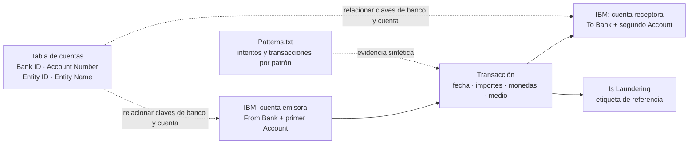

# Datos de banca: investigación de alertas AML

Fuentes consultadas el 17 de octubre de 2026:

- [IBM Transactions for Anti-Money Laundering](https://www.kaggle.com/datasets/ealtman2019/ibm-transactions-for-anti-money-laundering-aml), versión 8. Licencia indicada por el publicador: **Community Data License Agreement – Sharing 1.0**.
- [SAML-D](https://www.kaggle.com/datasets/berkanoztas/synthetic-transaction-monitoring-dataset-aml), versión 2. Licencia indicada por el publicador: **CC BY-NC-SA 4.0** (atribución, uso no comercial y compartir igual).

Ambos datasets contienen datos sintéticos. Las etiquetas corresponden al generador; no representan investigaciones de clientes reales.

## Alcance de la descarga

IBM completo ocupa 41,61 GB según Kaggle, frente a unos 17 GB libres al iniciar. Se descargan **HI-Small y LI-Small completos**, cada uno con transacciones, cuentas y patrones. No son muestras recortadas de Medium/Large: el autor describe las seis variantes como independientes.

SAML-D se descarga **completo**. El tamaño combinado esperado de los siete archivos locales es aproximadamente 2,20 GB decimales. Los archivos originales permanecen fuera de Git; sí se versionan metadatos, perfiles agregados y scripts.

```text
raw/
  ibm-aml/
    HI-Small_Trans.csv
    HI-Small_accounts.csv
    HI-Small_Patterns.txt
    LI-Small_Trans.csv
    LI-Small_accounts.csv
    LI-Small_Patterns.txt
  saml-d/
    SAML-D.csv
metadata/
  *-view.json              Metadatos de las fuentes
  *-files.json             Inventario de todos los archivos publicados
  download-manifest.json   Archivos descargados, versión, bytes y SHA-256
  profiles.json            Conteos y esquema de los CSV locales completos
```

## Reproducir

Desde la raíz del proyecto, con Python 3:

```bash
python3 scripts/descargar_datos_banca.py
python3 scripts/perfilar_datos_banca.py
python3 scripts/generar_visual_banca.py
```

La descarga usa la API pública de Kaggle sin credenciales, fija las versiones y verifica el tamaño de cada archivo. Si falta `pandas`, instalarlo en el entorno Python de trabajo con `python3 -m pip install pandas`. El perfil requiere `pandas`, procesa bloques de 100.000 filas y conserva identificadores como texto. Los perfiles contienen estadísticas del archivo completo; los ejemplos mostrados son solo unas pocas filas y no una muestra representativa.

[Diccionario de columnas y categorías observadas](DICCIONARIO.md). La vista interactiva se genera en `visualizaciones/esquema-banca.html`.

## Cómo leer el esquema



IBM repite el nombre `Account` en el CSV original. El lector de pandas denomina al segundo `Account.1`: es la cuenta receptora. Los nombres originales se conservan en el perfil. Las claves de banco requieren normalización de ceros iniciales al unir las tablas. En las primeras 1.000 transacciones de HI-Small hubo 0 coincidencias exactas con la tabla de cuentas y 1.000 coincidencias al quitar ceros iniciales del identificador de banco, tanto para emisor como para receptor. Conservar el valor original y crear una clave normalizada; los números de cuenta permanecen como texto. Esta comprobación es parcial, no una validación de integridad de todas las filas. No mezclar cuentas entre variantes HI y LI.

En SAML-D, cada fila contiene emisor, receptor, fecha/hora, monto, monedas, localizaciones bancarias y tipo de pago. El grafo se puede construir usando cuentas como nodos y transacciones como aristas; el paquete publicado contiene un CSV, no archivos de grafos separados. El autor describe 15 estructuras de red empleadas por el generador.

## Qué podemos construir con estos datos

- Reconstruir el historial de una cuenta y sus contrapartes.
- Seguir rutas y ventanas temporales de transferencias para investigar una alerta.
- Mostrar importes, monedas y medios de pago como evidencia del caso.
- Comparar patrones hallados con las etiquetas sintéticas y, en IBM, con `Patterns.txt`.
- En SAML-D, explorar las tipologías publicadas mediante `Laundering_type`.

`Is Laundering` / `Is_laundering`, `Laundering_type` y los archivos de patrones son **referencia para evaluación**. No se deben proporcionar al modelo que intenta detectar o investigar el caso como si fueran señales disponibles antes de conocer el resultado: eso filtraría la respuesta.

Estos datos no incluyen un expediente AML completo, normativa peruana, listas de sanciones ni decisiones humanas de investigación. Esos componentes requerirán fuentes adicionales o ejemplos claramente identificados como simulados.

## Inventario verificado

| Archivo | Filas | Columnas | Etiqueta 1 |
| --- | ---: | ---: | ---: |
| IBM HI-Small transacciones | 5.078.345 | 11 | 5.177 |
| IBM HI-Small cuentas | 518.581 | 5 | No aplica |
| IBM LI-Small transacciones | 6.924.049 | 11 | 3.565 |
| IBM LI-Small cuentas | 712.688 | 5 | No aplica |
| SAML-D transacciones | 9.504.852 | 12 | 9.873 |

Los perfiles no encontraron campos vacíos en estos cinco CSV. Esto no establece ausencia de otros problemas de calidad. HI, LI y SAML-D son universos sintéticos distintos: no deben unirse como si compartieran clientes.
